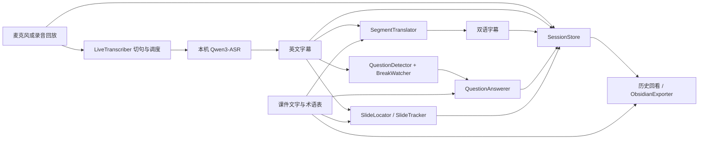

<!-- README_SYNC: source=671854a; updated=2026-11-04 -->
简体中文 · [English](./README_EN.md)

# ClassLens

为英文授课设计的 macOS 上课助手：在 Apple silicon 上本地转写课堂录音，用中文字幕、课件跟随和 AI 问答辅助听课，课后回看并导出记录。项目由作者为自己的计算机专业课程使用而制作。

**macOS 26+** · **Apple silicon** · **Swift 6** · **SwiftUI**

- **边听边看**：Qwen3-ASR 在本机生成英文字幕，所选的 AI 服务（DeepSeek、Claude 或 OpenAI）逐句翻译正式字幕；支持字幕浮窗。
- **关注老师的提问**：筛选面向全班的问题并生成参考答案；识别到老师宣布课间时暂停提问识别，也可手动恢复。
- **课件与字幕一起用**：打开 PDF 或 PPT，按转写跟随老师讲到的页；选中文字可解释、翻译或提问。
- **课后整理**：回看录音、字幕和问答，将转写、录音和 AI 总结导出到 Obsidian。

[快速开始](#快速开始) · [数据与隐私](#数据与隐私) · [验证与评估](#验证与评估)

## 快速开始

1. 准备 macOS 26 或更新版本的 Apple silicon Mac、Xcode 和 XcodeGen。仓库记录使用 Xcode 26.3；依赖由 SwiftPM 解析。`project.yml` 使用作者的 Apple Development 团队和手动签名，其他机器可能需要在本地配置适用的签名才能构建。
2. 在仓库根目录构建并启动：

   ```bash
   make run
   ```

3. 在 App 设置中选择 AI 服务（DeepSeek、Claude 或 OpenAI，默认 DeepSeek），填入自己的 API key 并保存。每家的 key 分开保存。首次使用识别时会从 Hugging Face 下载 `mlx-community/Qwen3-ASR-1.7B-8bit`，需要网络；首次录音时按系统提示授予麦克风权限。
4. 课前打开 PDF 或 PPT 课件，然后开始录音。PPT 由 PowerPoint 转为 PDF，PowerPoint 不可用时尝试 Keynote；需要安装其中之一，并在系统提示时允许自动化控制。也可以直接打开 PDF。
5. 课后在历史记录中打开课程回看；需要导出时选择 Obsidian 目标位置并检查待创建的文件。

其他构建命令：

```bash
make gen
make build
make release
make test
```

`make build` 是 Debug 构建；性能验证使用 `make release`。项目的构建、测试和验收约定见 [CLAUDE.md](./CLAUDE.md)。

## 使用方式与边界

- 正式英文字幕会逐句翻译；识别过程中也会显示临时英文字幕。课件术语表用于识别上下文、翻译和答题。
- 自动跟页根据转写判断当前课件页；模型不可用或关闭时回退到本机文字比对。手动翻页会暂停本节跟随，可恢复。跟页可能判断错误，特别是从课程中途开始时。
- 在课件或字幕中选中文字后，可使用浮出操作或右键菜单。`⌘E` 解释选中内容，`⇧⌘E` 就选中内容提问。
- 为减少误报，只有停顿、没有学生回答、老师复述或其他邀请/回应证据的问句不会被判作全班提问。因此，学生回答未被麦克风收录且老师只沉默等待时，真实提问可能漏掉。提示词已区分全班提问和一对一对话；用于调参的 SDPA 实验课误报从 4 个降到 0。FOAI 实验课和 LSDE Lecture 2 留出测试没有退步，但几乎没有一对一对话，不能有力验证这项修复（见[技术决策记录](./docs/decisions.md)）。课间规则依赖识别到的老师话语；导入课间停过录的外部录音时，暂停识别可能比实际课间长。
- 机器转写、翻译、AI 答案和总结都可能出错；请对照录音、课件和原始材料核对，不要把生成内容当成定论。

## 数据与隐私

音频在本机录制和识别，**不会作为音频上传**。录音、转写和课程记录保存在本机；使用翻译、术语提取、提问识别、答题、AI 跟页或总结时，相关的转写文本、课件文字和提问等上下文会发送给你在设置里选择的 AI 服务（DeepSeek、Anthropic 或 OpenAI）。使用的是你自己的 API key 和账户，调用会产生 API 费用。key 通过 App 设置保存到 macOS 钥匙串。

课程数据位于 `~/Library/Application Support/ClassLens/sessions/<session-id>/`。导出目录按作者自己的 Obsidian 库约定设计，使用相对结构 `模块/<课程>/资料/课堂记录/ClassLens/{转写,录音,AI总结}/`。导出只新建文件，不覆盖已有文件；同名时会规划其他文件名，实际写入时若目标已存在则报错。

## 架构



`SegmentTranslator`、`QuestionDetector`、`SlideLocator` 和术语提取使用所选服务的快速模型（`deepseek-flash`、`claude-haiku-5-5` 或 `gpt-6-luna`）；`QuestionAnswerer` 和课后总结使用较强的模型（`deepseek-v4-pro`、`claude-opus-5-5` 或 `gpt-6.1-sol`）。各项验收和评估目前只在 DeepSeek 下跑过。`SlideTracker` 提供本机文字比对回退。音频和字幕等由 `SessionStore` 保存，导出时可生成总结。

## 验证与评估

以下命令在仓库根目录执行；先运行 `make release`。将示例中的环境变量设为你自己的录音和课件路径。回放可能创建本地课程记录；翻译、提问识别和模型跟页会真实调用所选的 AI 服务并收费。只测识别时可加 `--asr-only`。

```bash
APP=build/Build/Products/Release/ClassLens.app/Contents/MacOS/ClassLens
"$APP" --replay "$AUDIO_FILE" --replay-start 600 --replay-duration 600 --replay-speed 1 --metrics-out build/replay-metrics.json --quit-when-done
"$APP" --bench-engine "$AUDIO_FILE" --replay-start 600
"$APP" --eval-questions Fixtures/questions/dev_0600.jsonl
python3 -I Bench/score_questions.py "$APP"
"$APP" --document "$SLIDES_PDF" --eval-slides Fixtures/slides_follow/scem_week7_full.jsonl
python3 -I Bench/score_slides.py "$APP" "$SLIDES_PDF" dev
```

`--replay-speed 0` 可用于不按实时速度等待的回放；`--document` 可在回放前打开课件。提问评估只用 `full_week7 --before 3000` 和 `sdpa_lab1` 调参，Week 7 的 3000 秒后部分及其他课程留作验收；模型结果会波动，留出集至少跑三次。跟页评估只用 `dev` 调参，`test` 留出。`CLASSLENS_SLIDES_MODE=llm` 或 `hybrid` 会触发模型调用；按项目约定，整课模型跟页评估只跑一次 `all`。评分脚本的 `--before` / `--from` 过滤的是评分结果，检测仍会处理所选转写。`CLASSLENS_TRACE=1` 可打印识别任务耗时；`CLASSLENS_SLIDES` 可覆盖跟页评估参数。真实课件不在仓库中。提问识别和跟页的评估集是真实课堂的逐字转写，涉及授课老师的课堂内容，不在公开仓库中；上面两条 `Fixtures/questions`、`Fixtures/slides_follow` 命令需要自备转写和标注。完整参数和验收线见 [CLAUDE.md](./CLAUDE.md) 与 [LaunchOptions.swift](./ClassLens/App/LaunchOptions.swift)。

[技术决策记录](./docs/decisions.md)记录了截至 2026-11-04 的实验，以下是 Release 离线提问评估的记录，不代表跨课程的准确率。表中日期是评估记录日期；除另有说明，留出课程均在检测前标注且未用于调参。

| 评估范围 | 日期与用途 | 结果 |
| --- | --- | --- |
| SCEM Week 7，约 112 分钟整课；另有三段各 10 分钟窗口 | 2026-11-03；整课前 3000 秒及 `dev_0600` 为调参范围，后半段及 `heldout_3000`、`heldout_5400` 为留出 | 一对一修复后各跑一次：整课 6/6 个已知提问、误报 0；两段留出窗口的 3 个已知提问全中；`dev_0600` 2/2、误报 0。此前整课两次均为 6/6、误报 0。 |
| SDPA 实验课，约 87 分钟 | 2026-11-03；一对一修复的调参集，已不是留出集 | 没有标注出的全班提问，误报 4 → 0（修复后跑一次）。 |
| SDPA Lecture 1，76 分钟 | 2026-11-03；留出 | 修复后跑三次，召回分别为 8/10、6/10、7/10，误报分别为 0、1、0；修复前跑三次，召回分别为 7/10、8/10、7/10，误报均为 0。 |
| FOAI 实验课，16 分钟 | 2026-11-04；留出 | 没有标注出的全班提问；修复前、后各跑三次，误报均为 0。 |
| LSDE Lecture 2，67 分钟 | 2026-11-04；留出 | 修复前、后各跑三次，召回均为 1/1；修复前每次误报 1 个，修复后均为 0。 |

Week 7 整课标注没有通读全文寻找漏问，课间规则也依据这节课编写；`dev_0600` 中一处问句三次只识别到一次，看到结果后才将其标注改为“拿不准”，与整课标注保持一致。SDPA Lecture 1 是另一位老师的问答式讲课，转写每句被 15 s 上限切开，没有停顿信息；召回约七成，两个提问在新旧版本中都稳定漏掉，因此 M3“已知真提问全部识别”的验收线在这节课上未达到。FOAI 和 LSDE 的结果没有退步，但两节课几乎没有一对一对话，对该修复不是有力验证。

同一节 Week 7 的跟页模型在留出点上为 13/16 完全匹配、15/16 在前后一张以内。换老师、录音条件或课件，结果可能不同；高负载下识别延迟也曾超出验收线，原因尚未确定。

## 借鉴与许可

[Nomi](https://github.com/Jasonsu22/Nomi) 的 App 部分为 MIT；项目复用的代码在相应文件头注明出处。[LectureFlow](https://github.com/ShouldBeQuincy/LectureFlow)、OpenLecture（AGPL）和 LectureLive（GPL）只借鉴思路，不复制代码。更多来源及许可信息见 [docs/references.md](./docs/references.md)。

本项目暂未选择许可证。
