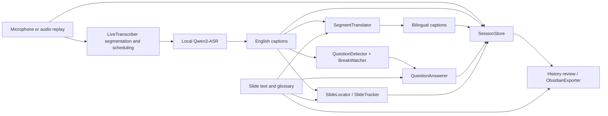

<!-- README_SYNC: source=671854a; updated=2026-11-04 -->
[简体中文](./README.md) · English

# ClassLens

A macOS lecture companion for English-taught classes. ClassLens transcribes audio locally on Apple silicon, adds Chinese subtitles, follows lecture slides and provides AI-assisted answers. It was built for the author's own computer science coursework.

**macOS 26+** · **Apple silicon** · **Swift 6** · **SwiftUI**

- **Listen with captions:** Qwen3-ASR produces English transcripts on the Mac; DeepSeek translates finalized segments into Chinese. A floating subtitle window is available.
- **Follow class questions:** the app looks for questions directed at the class and generates suggested answers. Question spotting pauses when a break is detected and can be resumed manually.
- **Keep slides in context:** open a PDF or PPT, follow the lecturer's current page, and select slide or caption text to explain, translate or ask about it.
- **Review later:** replay the recording alongside captions and questions, then export the transcript, audio and AI summary to Obsidian.

[Quick start](#quick-start) · [Data and privacy](#data-and-privacy) · [Verification and evaluation](#verification-and-evaluation)

## Quick start

1. Use an Apple silicon Mac running macOS 26 or later, with Xcode and XcodeGen. The repository records Xcode 26.3 as the development environment; SwiftPM resolves dependencies. `project.yml` uses the author's Apple Development team and manual signing, so another machine may need locally appropriate signing settings to build.
2. From the repository root, build and launch:

   ```bash
   make run
   ```

3. Enter and save your own DeepSeek API key in the app's settings. On first use, speech recognition downloads `mlx-community/Qwen3-ASR-1.7B-8bit` from Hugging Face and needs a network connection. Grant microphone access when macOS asks.
4. Open a PDF or PPT before class, then start recording. PowerPoint converts PPT files to PDF; Keynote is the fallback if PowerPoint is unavailable. Install one of them and grant automation permission when prompted, or open a PDF directly.
5. After class, open the lecture in the history sidebar to review it. For export, choose an Obsidian destination and inspect the files to be created.

Other build commands:

```bash
make gen
make build
make release
make test
```

`make build` creates a Debug build; use `make release` for performance measurements. See [CLAUDE.md](./CLAUDE.md) for build, test and acceptance conventions.

## Workflow and limitations

- Final English segments are translated one at a time; provisional English captions also appear while speech is being recognized. A slide glossary supplies context for recognition, translation and answers.
- Slide following uses the transcript to estimate the lecturer's current page, falling back to local text matching if the model is unavailable or disabled. Manual page changes pause following for the current lecture; it can be resumed. Page estimates can be wrong, especially when recording starts mid-lecture.
- Select text in a slide or caption and use the floating actions or context menu. `⌘E` explains the selection; `⇧⌘E` asks a question about it.
- To reduce false positives, a question followed only by silence is not counted without evidence such as a student answer, a repeated question, an invitation or a response from the lecturer. A real question can therefore be missed if the microphone does not pick up a student's answer and the lecturer only waits. The prompt now distinguishes class questions from one-on-one conversations; false positives fell from 4 to 0 on the SDPA lab used for tuning. Held-out FOAI lab and LSDE Lecture 2 results showed no regression, but contain almost no one-on-one conversation and do not strongly validate that fix (see the [decision log](./docs/decisions.md)). Break detection depends on recognized lecturer speech; when an imported recording was paused over a break, question detection may stay paused longer than the actual break.
- Transcripts, translations, AI answers and summaries can all be wrong. Check them against the recording, slides and original materials before relying on them.

## Data and privacy

Audio is recorded and recognized on the Mac and **is not uploaded as audio**. Recordings, transcripts and lecture records are stored locally. When using translation, glossary extraction, question spotting, answering, AI slide following or summarization, relevant transcript text, slide text, questions and other context are sent to DeepSeek. Calls use your own API key and account and incur API charges. The app saves the key in the macOS Keychain.

Session data is stored under `~/Library/Application Support/ClassLens/sessions/<session-id>/`. Export follows the author's own Obsidian vault convention, using the relative structure `模块/<课程>/资料/课堂记录/ClassLens/{转写,录音,AI总结}/`. It creates new files only and does not overwrite existing files; a different name is planned for a collision, and the write fails if the target already exists.

## Architecture



`SegmentTranslator`, `QuestionDetector`, `SlideLocator` and glossary extraction use `deepseek-flash`; `QuestionAnswerer` and the post-lecture summary use `deepseek-v4-pro`. `SlideTracker` provides the local text-matching fallback. `SessionStore` saves audio, captions and other session data; export can generate a summary.

## Verification and evaluation

Run these from the repository root after `make release`. Set the example environment variables to your own recording and slide paths. Replay may create local session records; translation, question spotting and model-based slide following make real, billable DeepSeek calls. Add `--asr-only` to test recognition alone.

```bash
APP=build/Build/Products/Release/ClassLens.app/Contents/MacOS/ClassLens
"$APP" --replay "$AUDIO_FILE" --replay-start 600 --replay-duration 600 --replay-speed 1 --metrics-out build/replay-metrics.json --quit-when-done
"$APP" --bench-engine "$AUDIO_FILE" --replay-start 600
"$APP" --eval-questions Fixtures/questions/dev_0600.jsonl
python3 -I Bench/score_questions.py "$APP"
"$APP" --document "$SLIDES_PDF" --eval-slides Fixtures/slides_follow/scem_week7_full.jsonl
python3 -I Bench/score_slides.py "$APP" "$SLIDES_PDF" dev
```

Use `--replay-speed 0` for replay without real-time pacing, and `--document` to open slides before replay. For question evaluation, tune only on `full_week7 --before 3000` and `sdpa_lab1`; reserve the Week 7 portion from 3000 seconds onward and the other courses for acceptance. Model results vary, so run held-out sets at least three times. For slide following, tune on `dev` and reserve `test`. `CLASSLENS_SLIDES_MODE=llm` or `hybrid` invokes the model; the project convention is to run the full-lecture model evaluation once with `all`. The scoring script’s `--before` / `--from` filters apply to scoring; detection still processes the selected transcript. `CLASSLENS_TRACE=1` prints recognition task timings, and `CLASSLENS_SLIDES` overrides slide-evaluation parameters. The actual course slides are not included in the repository. The question-spotting and slide-following evaluation sets are verbatim transcripts of real lectures and are left out of the public repository, so the `Fixtures/questions` and `Fixtures/slides_follow` commands above need your own transcripts and labels. See [CLAUDE.md](./CLAUDE.md) and [LaunchOptions.swift](./ClassLens/App/LaunchOptions.swift) for all options and acceptance criteria.

The [decision log](./docs/decisions.md) records experiments through 2026-11-04. These Release offline question evaluations are not accuracy guarantees across courses. Dates below are the dates of the evaluation records; unless noted otherwise, held-out courses were labelled before detection and were not used for tuning.

| Evaluation scope | Date and role | Results |
| --- | --- | --- |
| SCEM Week 7, approximately 112 minutes in full, plus three 10-minute windows | 2026-11-03; the first 3000 seconds and `dev_0600` are for tuning; the later portion and `heldout_3000` and `heldout_5400` are held out | One run each after the one-on-one fix: the full lecture found 6/6 known questions with 0 false positives, both held-out windows found all 3 known questions, and `dev_0600` found 2/2 with 0 false positives. Two earlier full-lecture runs each found 6/6 with 0 false positives. |
| SDPA lab, approximately 87 minutes | 2026-11-03; tuning set for the one-on-one fix, no longer held out | No class questions were labelled; false positives fell from 4 to 0 (one run after the fix). |
| SDPA Lecture 1, 76 minutes | 2026-11-03; held out | Three post-fix runs found 8/10, 6/10 and 7/10 questions, with 0, 1 and 0 false positives respectively. Three pre-fix runs found 7/10, 8/10 and 7/10, each with 0 false positives. |
| FOAI lab, 16 minutes | 2026-11-04; held out | No class questions were labelled; each of three runs before and three after the fix had 0 false positives. |
| LSDE Lecture 2, 67 minutes | 2026-11-04; held out | All three runs before and after the fix found 1/1; each pre-fix run had 1 false positive, and each post-fix run had 0. |

The full Week 7 transcript was not exhaustively labelled for missed questions, and its break rule was written using that lecture. One question in `dev_0600` was detected in only one of three runs; after seeing the result, its label was changed to ambiguous to match the full-lecture label. SDPA Lecture 1 is a question-and-answer-style lecture by another lecturer; every transcript segment was forced to split at the 15 s limit, leaving no pause information. Recall was around 70%, and both versions consistently missed two questions. The M3 acceptance criterion of finding every known real question was therefore not met on this lecture. FOAI and LSDE showed no regression, but contain almost no one-on-one conversation, so they provide weak evidence for the fix itself.

On held-out points from the same Week 7 lecture, model-based slide following matched 13/16 exactly and 15/16 within one slide. Results may differ with another lecturer, recording or slide deck. Recognition latency also exceeded its target under heavy load; the cause remains unconfirmed.

## Acknowledgements and licence

The app portion of [Nomi](https://github.com/Jasonsu22/Nomi) is MIT licensed; reused code is credited in the relevant file headers. [LectureFlow](https://github.com/ShouldBeQuincy/LectureFlow), OpenLecture (AGPL) and LectureLive (GPL) informed ideas only; their code was not copied. See [docs/references.md](./docs/references.md) for the complete list of sources and licence notes.

No licence has been selected for this project yet.
